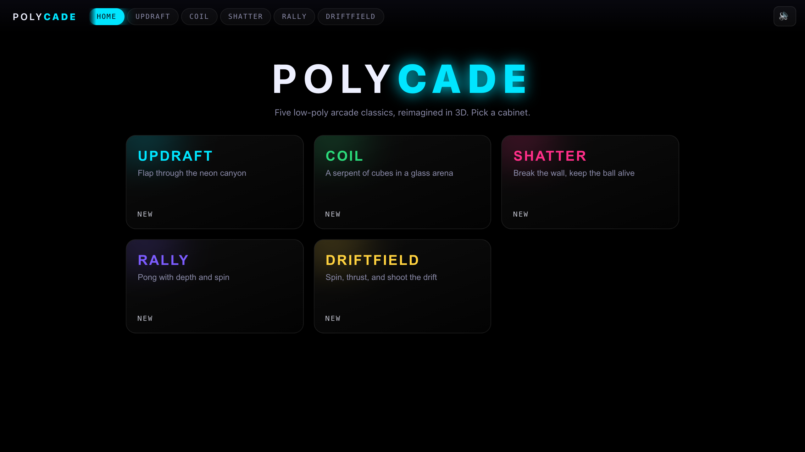
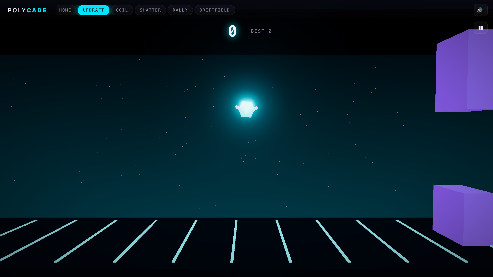
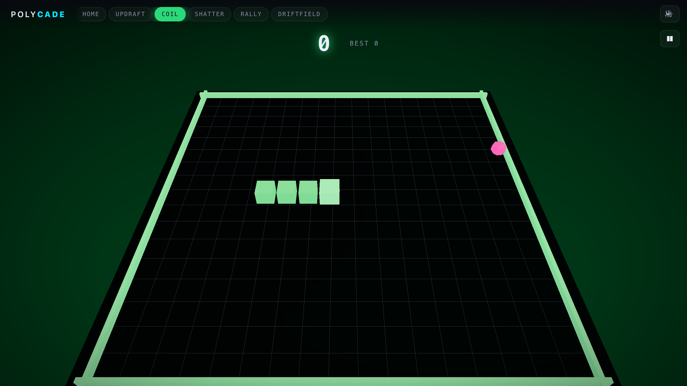
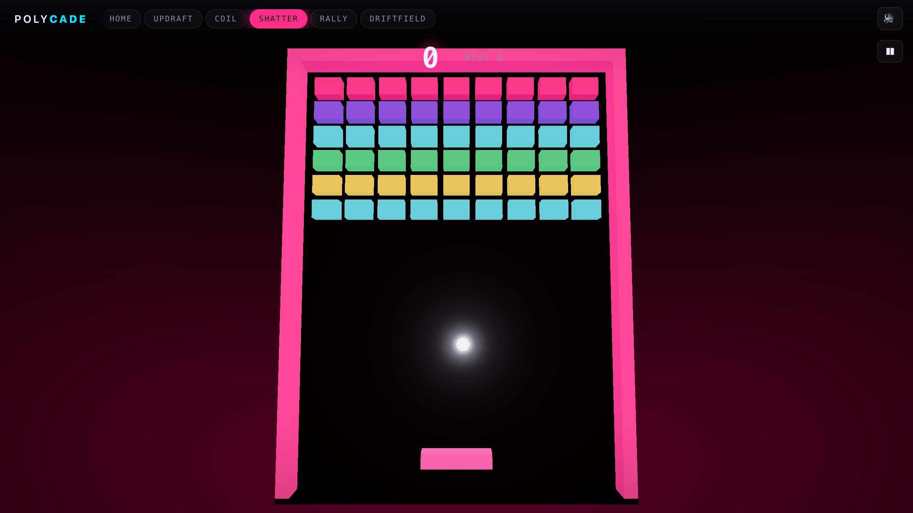
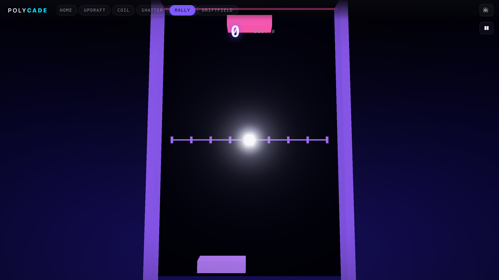
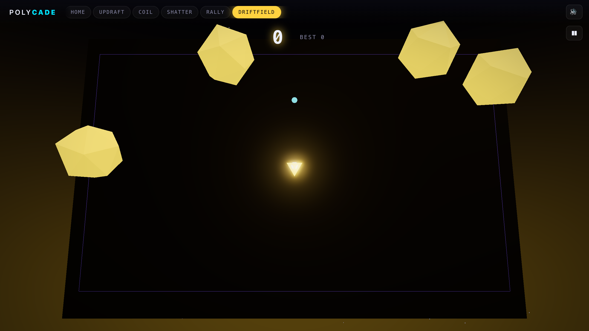

# POLYCADE

[](https://github.com/robotismo/polycade/actions/workflows/ci.yml)

Five low-poly arcade classics, reimagined in 3D and rendered with [three.js](https://threejs.org). One cohesive neon-on-dark product, playable on desktop and phone, with high scores that persist across reloads. Every game ships as its own lazily-loaded tab, so you only download the cabinet you open.

**▶ Live: https://robotismo.github.io/polycade/** — deploys to GitHub Pages via CI on every push to `main`.



## The five games

| Game | Classic | Twist | Controls (desktop) | Controls (touch) |
|------|---------|-------|--------------------|------------------|
| **Updraft** | Flappy Bird | Flap through a neon canyon with real depth, lighting & parallax | `Space` / `↑` / click to flap | tap anywhere |
| **Coil** | Snake | A serpent of glowing cubes on a 3D tabletop arena | arrow keys to turn | swipe or on-screen d-pad |
| **Shatter** | Breakout | Bricks and ball in a lit 3D frame, endless walls | `←` `→` / mouse to move paddle | drag / side buttons |
| **Rally** | Pong | Vertical court with depth, spin and a beatable AI | `←` `→` / mouse to move paddle | drag / side buttons |
| **Driftfield** | Asteroids | Rotate, thrust and shoot in a wrapping field | `←` `→` rotate, `↑` thrust, `Space` fire | rotate + thrust/fire buttons |

Best score per game is shown on its cabinet on the home screen and in the HUD, and survives a page reload (and works offline — POLYCADE is an installable PWA).

<p align="center">
  
  
  
  
  
</p>

## Architecture

A single Vite app with a shared engine; games are mounted into one persistent WebGL renderer.

```
src/
  engine/     fixed-timestep deterministic loop, Game interface, Engine runtime,
              object pool, seeded RNG, pure collision math, settings
  input/      unified semantic input (keyboard + pointer + touch/swipe + gamepad)
  score/      ScoreStore interface + localStorage implementation (cloud-ready)
  art/        shared palette/motion tokens, materials, lighting rig, bloom post stack
  audio/      synthesized Web Audio SFX (no asset files)
  shell/      tab routing, home grid, HUD, overlays, mobile controls, settings
  games/<id>/ one self-contained game per folder (its own lazy chunk)
```

Key decisions:

- **Genuine 3D**, not 2D faked in three.js — the mandated tech is the right tech only if the games are real 3D reinterpretations.
- **One shared `WebGLRenderer`** owned by the shell; each game owns only its scene/camera and is disposed on tab switch, so the home → game → home loop never exhausts WebGL contexts.
- **Deterministic fixed-timestep simulation** (`update(dt)` with constant `dt`, seeded RNG) — the same property that makes gameplay framerate-independent makes it unit-testable and lets headless E2E drive real input step-by-step.
- **`ScoreStore` interface** in front of localStorage so a cloud leaderboard can drop in later without touching game code.
- **Juice without breaking determinism** — camera shake, particle bursts and scale-pops live in the render layer (`frame()`), never the fixed-step simulation, so they add punch while the sim stays deterministic and unit-testable.
- **Accessibility & reduced motion** — full keyboard focus rings, ARIA on the grid/tabs/score, restored pinch-zoom, and a `prefers-reduced-motion` path that also weakens bloom and caps pixel ratio (not just CSS). Installable PWA with a network-first service worker so a redeploy never strands a returning user on a stale shell.

## Develop

```bash
npm install
npm run dev        # http://localhost:5173
npm run build      # typecheck + production build to dist/
npm run preview    # serve the production build on :4173
```

## Test

```bash
npm test                 # Vitest — scoring, RNG, collision math, input state machine
npm run e2e:install      # one-time: install the Playwright browser
npm run e2e              # Playwright — per-game: load → real input → score →
                         # game-over → reload → high-score persists; desktop + mobile
npm run lint             # ESLint
npm run typecheck        # tsc --noEmit
```

CI (`.github/workflows/ci.yml`) runs lint, typecheck, unit tests, build and the full Playwright suite on every push/PR, then deploys to GitHub Pages from `main`.

## Tech

TypeScript · Vite · three.js · Web Audio · Vitest · Playwright · GitHub Actions. No game art assets — all geometry, color and sound are generated at runtime.

## License

MIT — see [LICENSE](LICENSE). Original names and original art for every game; the classics are reimplemented mechanics, not copied assets.
